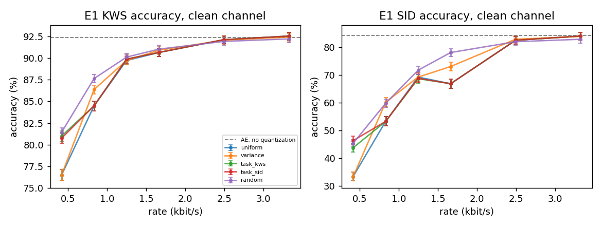
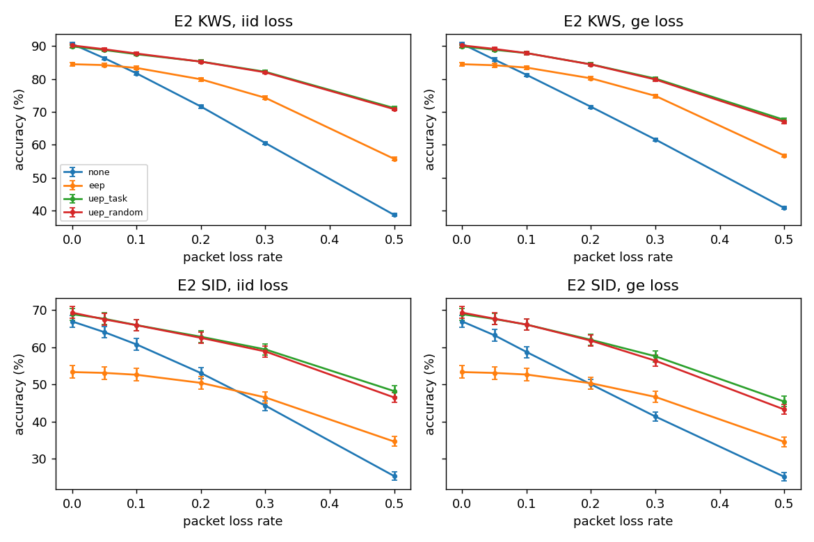

# TaskCodec: task-aware bit allocation and loss protection for a learned speech codec

*This README is generated by `python -m taskcodec.report` from `results/*.json`; every number below is read from those files. Run `python -m taskcodec.report --check` to verify.*

## Question

When the bit budget is fixed and the channel drops packets, does spending bits and error protection according to the downstream task (keyword spotting, speaker ID) beat spending them uniformly or by reconstruction variance?

## What was built

- A small CNN autoencoder on 40-bin log-mel (360k parameters) whose latent is split into G groups; a per-group scalar quantizer with a fixed bit budget; training with random per-group bit depth, random packet loss, an extra loss that keeps the decoded features close to what the two frozen task models see (their embeddings, weight 1.0), and, for 50% of training clips, only the first k groups kept (ordered latent).
- Allocation policies: `uniform`, `variance` (reverse water-filling), `task_kws` / `task_sid` (gradient sensitivity of the task loss, measured on validation data only), and a `random` control.
- A packet-loss channel (i.i.d. and Gilbert-Elliott bursts) with three protection schemes at **equal total bitrate**: none, equal error protection (EEP, every group sent twice) and unequal error protection (UEP, only the top-sensitivity groups sent twice; `uep_random` protects random groups as a control).
- Two tasks on Google Speech Commands v2: 35-word keyword spotting and closed-set speaker ID over the 100 speakers with the most clips. Task models are trained on clean features and frozen.

Data: 105829 clips; KWS train/val/test = 84843/9981/11005; SID train/val/test = 9794/2082/2101. Autoencoder training clips: 81212 (official train, SID val/test clips excluded). Test data is used only in the experiment runner. Dataset: Google Speech Commands v2 by Pete Warden, licensed CC BY 4.0 ([paper](https://arxiv.org/abs/1804.03209)).

Frozen task models on original features: KWS test accuracy 96.7%, SID test accuracy 99.5%.

## Findings

- **Task-aware allocation reproduced the uniform allocation at whole-number budgets.** At [1.0, 2.0, 3.0, 4.0] bit/element the `task_kws` and `task_sid` plans are identical to `uniform`, so their accuracy is identical. The measured task sensitivities are nearly flat (largest over smallest group: 1.5-1.7x across autoencoder seeds), so the greedy rule keeps the allocation even; the only differences are at the fractional budgets [0.5, 1.5], where leftover bits go to different groups. This is a null result for task-aware allocation in this design, not evidence that it cannot help.
- **The ordered latent made reconstruction variance informative.** The group variances now differ (2.5-2.6x largest over smallest), so `variance` gives non-uniform plans at [1.0, 2.0, 3.0, 4.0] bit/element and changes accuracy there (see tables); the task-based policies did not move.
- KWS accuracy % by policy: 0.5 bit/el: uniform 76.5, variance 76.5, random 81.4; 1.0 bit/el: uniform 84.5, variance 86.4, random 87.6; 1.5 bit/el: uniform 89.7, variance 89.7, random 90.1; 2.0 bit/el: uniform 90.7, variance 90.9, random 91.0; 3.0 bit/el: uniform 92.1, variance 92.1, random 91.9; 4.0 bit/el: uniform 92.5, variance 92.4, random 92.2.
- SID accuracy % by policy: 0.5 bit/el: uniform 33.4, variance 33.4, random 45.4; 1.0 bit/el: uniform 53.3, variance 60.2, random 59.8; 1.5 bit/el: uniform 69.3, variance 69.3, random 71.8; 2.0 bit/el: uniform 66.9, variance 73.1, random 78.1; 3.0 bit/el: uniform 82.6, variance 82.9, random 82.1; 4.0 bit/el: uniform 84.1, variance 83.9, random 82.9.
- Paired differences, task-based policy minus other policy on KWS: variance at 0.5 bit/el +4.5 pp [+4.1, +4.9]; random at 0.5 bit/el -0.4 pp [-0.8, -0.1]; variance at 1.0 bit/el -1.9 pp [-2.1, -1.6]; random at 1.0 bit/el -3.2 pp [-3.5, -2.8]; variance at 1.5 bit/el +0.2 pp [-0.0, +0.4]; random at 1.5 bit/el -0.2 pp [-0.4, -0.0]; variance at 2.0 bit/el -0.3 pp [-0.4, -0.1]; random at 2.0 bit/el -0.4 pp [-0.6, -0.2]; variance at 3.0 bit/el +0.1 pp [-0.1, +0.2]; random at 3.0 bit/el +0.2 pp [+0.1, +0.3]; variance at 4.0 bit/el +0.1 pp [+0.0, +0.2]; random at 4.0 bit/el +0.3 pp [+0.2, +0.4]. Negative values mean the other policy scored higher.
- Paired differences, task-based policy minus other policy on SID: variance at 0.5 bit/el +13.0 pp [+11.7, +14.2]; random at 0.5 bit/el +1.0 pp [-0.1, +2.0]; variance at 1.0 bit/el -6.9 pp [-7.9, -5.9]; random at 1.0 bit/el -6.5 pp [-7.7, -5.4]; variance at 1.5 bit/el -0.4 pp [-1.1, +0.2]; random at 1.5 bit/el -2.9 pp [-3.7, -2.1]; variance at 2.0 bit/el -6.2 pp [-7.0, -5.4]; random at 2.0 bit/el -11.2 pp [-12.4, -10.1]; variance at 3.0 bit/el -0.4 pp [-0.9, +0.1]; random at 3.0 bit/el +0.5 pp [-0.0, +1.1]; variance at 4.0 bit/el +0.1 pp [-0.1, +0.4]; random at 4.0 bit/el +1.2 pp [+0.7, +1.6]. Negative values mean the other policy scored higher.
- **Speaker ID is badly hurt by the mel-latent codec itself.** SID accuracy is 99.5% on original features and 84.3% after the autoencoder with no quantization; KWS drops from 96.7% to 92.4%. Quantizing at 2 bit/element gives KWS 90.7% and SID 66.9%.
- **Protection helps under loss (KWS, i.i.d. loss 10%, equal total bitrate).** UEP vs no protection: +5.8 pp [+5.5, +6.1]; UEP vs EEP: +4.2 pp [+3.8, +4.5]; task-selected UEP vs randomly selected UEP: -0.2 pp [-0.3, -0.1] (worse). The benefit comes from repeating some groups, not from choosing them by task sensitivity.
- **Protection helps under loss (SID, i.i.d. loss 10%, equal total bitrate).** UEP vs no protection: +5.2 pp [+4.3, +6.0]; UEP vs EEP: +13.3 pp [+12.1, +14.5]; task-selected UEP vs randomly selected UEP: +0.0 pp [-0.4, +0.4] (no clear difference). The benefit comes from repeating some groups, not from choosing them by task sensitivity.
- Equal-bitrate check across schemes in E2: passed (max slack 0 bits of 1664).

## E1: rate-accuracy on a clean channel

Accuracy % [95% bootstrap CI over test clips], mean over 3 autoencoder seeds. Rates in kbit/s for a 1 s clip.

**KWS**

| policy | 0.5 bit/el (0.42 kbps) | 1.0 bit/el (0.83 kbps) | 1.5 bit/el (1.25 kbps) | 2.0 bit/el (1.66 kbps) | 3.0 bit/el (2.50 kbps) | 4.0 bit/el (3.33 kbps) |
|---|---|---|---|---|---|---|
| uniform | 76.5 [75.8, 77.1] | 84.5 [83.9, 85.0] | 89.7 [89.2, 90.2] | 90.7 [90.2, 91.1] | 92.1 [91.7, 92.6] | 92.5 [92.1, 93.0] |
| variance | 76.5 [75.8, 77.1] | 86.4 [85.8, 86.9] | 89.7 [89.2, 90.2] | 90.9 [90.4, 91.4] | 92.1 [91.6, 92.5] | 92.4 [92.0, 92.9] |
| task_kws | 81.0 [80.4, 81.6] | 84.5 [83.9, 85.0] | 89.9 [89.4, 90.4] | 90.7 [90.2, 91.1] | 92.1 [91.7, 92.6] | 92.5 [92.1, 93.0] |
| task_sid | 80.7 [80.2, 81.3] | 84.5 [83.9, 85.0] | 89.9 [89.4, 90.3] | 90.7 [90.2, 91.1] | 92.1 [91.7, 92.6] | 92.5 [92.1, 93.0] |
| random | 81.4 [80.9, 81.9] | 87.6 [87.2, 88.1] | 90.1 [89.7, 90.6] | 91.0 [90.6, 91.5] | 91.9 [91.5, 92.4] | 92.2 [91.8, 92.6] |

**SID**

| policy | 0.5 bit/el (0.42 kbps) | 1.0 bit/el (0.83 kbps) | 1.5 bit/el (1.25 kbps) | 2.0 bit/el (1.66 kbps) | 3.0 bit/el (2.50 kbps) | 4.0 bit/el (3.33 kbps) |
|---|---|---|---|---|---|---|
| uniform | 33.4 [31.9, 35.0] | 53.3 [51.6, 55.0] | 69.3 [67.7, 70.9] | 66.9 [65.3, 68.5] | 82.6 [81.2, 83.9] | 84.1 [82.7, 85.4] |
| variance | 33.4 [31.9, 35.0] | 60.2 [58.6, 61.9] | 69.3 [67.7, 70.9] | 73.1 [71.6, 74.6] | 82.9 [81.6, 84.3] | 83.9 [82.6, 85.3] |
| task_kws | 43.8 [42.3, 45.4] | 53.3 [51.6, 55.0] | 68.7 [67.1, 70.3] | 66.9 [65.3, 68.5] | 82.6 [81.2, 83.9] | 84.1 [82.7, 85.4] |
| task_sid | 46.4 [44.8, 47.9] | 53.3 [51.6, 55.0] | 68.9 [67.3, 70.4] | 66.9 [65.3, 68.5] | 82.6 [81.2, 83.9] | 84.1 [82.7, 85.4] |
| random | 45.4 [44.1, 46.8] | 59.8 [58.4, 61.3] | 71.8 [70.3, 73.2] | 78.1 [76.7, 79.5] | 82.1 [80.7, 83.4] | 82.9 [81.6, 84.2] |



## E2: robustness to packet loss (total channel budget 1664 bits per clip)

Accuracy % [95% CI]; 'retained' is accuracy divided by the same scheme's accuracy at 0% loss. Source bits show how many bits remain for the signal after repetitions.

**KWS, iid loss**

| policy + scheme | source bits | p=0.0 | p=0.05 | p=0.1 | p=0.2 | p=0.3 | p=0.5 |
|---|---|---|---|---|---|---|---|
| task_kws + none | 1664 | 90.7 [90.2, 91.1] (100%) | 86.3 [85.9, 86.8] (95%) | 81.7 [81.2, 82.2] (90%) | 71.6 [71.1, 72.1] (79%) | 60.5 [60.0, 61.0] (67%) | 38.6 [38.2, 39.1] (43%) |
| task_kws + eep | 832 | 84.5 [83.9, 85.0] (100%) | 84.2 [83.7, 84.8] (100%) | 83.4 [82.8, 83.9] (99%) | 79.9 [79.3, 80.4] (95%) | 74.3 [73.7, 74.8] (88%) | 55.7 [55.2, 56.2] (66%) |
| task_kws + uep_task | 1300 | 89.9 [89.4, 90.4] (100%) | 88.8 [88.3, 89.3] (99%) | 87.5 [87.0, 88.0] (97%) | 85.3 [84.8, 85.8] (95%) | 82.2 [81.7, 82.7] (91%) | 71.1 [70.6, 71.6] (79%) |
| task_kws + uep_random | 1404 | 90.2 [89.7, 90.7] (100%) | 89.0 [88.6, 89.5] (99%) | 87.7 [87.3, 88.2] (97%) | 85.3 [84.8, 85.7] (95%) | 82.0 [81.5, 82.5] (91%) | 70.8 [70.3, 71.3] (78%) |
| variance + none | 1664 | 90.9 [90.4, 91.4] (100%) | 86.6 [86.1, 87.0] (95%) | 81.9 [81.4, 82.4] (90%) | 71.9 [71.4, 72.4] (79%) | 60.9 [60.4, 61.4] (67%) | 38.8 [38.4, 39.2] (43%) |
| variance + eep | 832 | 86.4 [85.8, 86.9] (100%) | 86.1 [85.6, 86.6] (100%) | 85.3 [84.7, 85.8] (99%) | 81.9 [81.4, 82.4] (95%) | 76.4 [75.8, 76.9] (88%) | 57.9 [57.4, 58.4] (67%) |
| uniform + none | 1664 | 90.7 [90.2, 91.1] (100%) | 86.3 [85.9, 86.8] (95%) | 81.7 [81.2, 82.2] (90%) | 71.6 [71.1, 72.1] (79%) | 60.5 [60.0, 61.0] (67%) | 38.6 [38.2, 39.1] (43%) |

**KWS, ge loss**

| policy + scheme | source bits | p=0.0 | p=0.05 | p=0.1 | p=0.2 | p=0.3 | p=0.5 |
|---|---|---|---|---|---|---|---|
| task_kws + none | 1664 | 90.7 [90.2, 91.1] (100%) | 85.9 [85.4, 86.4] (95%) | 81.2 [80.8, 81.7] (90%) | 71.5 [71.1, 72.0] (79%) | 61.6 [61.1, 62.0] (68%) | 40.7 [40.3, 41.2] (45%) |
| task_kws + eep | 832 | 84.5 [83.9, 85.0] (100%) | 84.2 [83.6, 84.7] (100%) | 83.5 [82.9, 84.0] (99%) | 80.2 [79.7, 80.7] (95%) | 74.8 [74.3, 75.4] (89%) | 56.7 [56.2, 57.2] (67%) |
| task_kws + uep_task | 1300 | 89.9 [89.4, 90.4] (100%) | 88.9 [88.4, 89.3] (99%) | 87.9 [87.4, 88.3] (98%) | 84.4 [84.0, 84.9] (94%) | 80.1 [79.6, 80.6] (89%) | 67.5 [67.1, 68.0] (75%) |
| task_kws + uep_random | 1404 | 90.2 [89.7, 90.7] (100%) | 89.1 [88.7, 89.6] (99%) | 87.9 [87.4, 88.3] (97%) | 84.4 [83.9, 84.9] (94%) | 79.8 [79.4, 80.3] (89%) | 67.0 [66.5, 67.4] (74%) |
| variance + none | 1664 | 90.9 [90.4, 91.4] (100%) | 86.2 [85.7, 86.6] (95%) | 81.5 [81.1, 82.0] (90%) | 71.8 [71.4, 72.3] (79%) | 61.8 [61.4, 62.2] (68%) | 40.9 [40.5, 41.3] (45%) |
| variance + eep | 832 | 86.4 [85.8, 86.9] (100%) | 86.0 [85.5, 86.6] (100%) | 85.3 [84.8, 85.8] (99%) | 82.1 [81.6, 82.6] (95%) | 76.7 [76.2, 77.2] (89%) | 58.7 [58.2, 59.2] (68%) |
| uniform + none | 1664 | 90.7 [90.2, 91.1] (100%) | 85.9 [85.4, 86.4] (95%) | 81.2 [80.8, 81.7] (90%) | 71.5 [71.1, 72.0] (79%) | 61.6 [61.1, 62.0] (68%) | 40.7 [40.3, 41.2] (45%) |

**SID, iid loss**

| policy + scheme | source bits | p=0.0 | p=0.05 | p=0.1 | p=0.2 | p=0.3 | p=0.5 |
|---|---|---|---|---|---|---|---|
| task_sid + none | 1664 | 66.9 [65.3, 68.5] (100%) | 64.0 [62.5, 65.6] (96%) | 60.7 [59.2, 62.3] (91%) | 53.0 [51.6, 54.5] (79%) | 44.3 [42.9, 45.6] (66%) | 25.4 [24.2, 26.5] (38%) |
| task_sid + eep | 832 | 53.3 [51.6, 55.0] (100%) | 53.1 [51.4, 54.8] (100%) | 52.6 [50.9, 54.2] (99%) | 50.4 [48.8, 52.0] (95%) | 46.5 [45.0, 48.0] (87%) | 34.6 [33.3, 36.0] (65%) |
| task_sid + uep_task | 1300 | 68.9 [67.3, 70.4] (100%) | 67.6 [66.1, 69.2] (98%) | 65.9 [64.4, 67.4] (96%) | 62.8 [61.3, 64.3] (91%) | 59.4 [57.9, 60.9] (86%) | 48.2 [46.8, 49.6] (70%) |
| task_sid + uep_random | 1404 | 69.3 [67.7, 70.9] (100%) | 67.5 [65.9, 69.0] (97%) | 65.9 [64.4, 67.4] (95%) | 62.5 [61.0, 64.0] (90%) | 58.8 [57.4, 60.3] (85%) | 46.5 [45.1, 47.9] (67%) |
| variance + none | 1664 | 73.1 [71.6, 74.6] (100%) | 70.2 [68.6, 71.7] (96%) | 66.7 [65.2, 68.2] (91%) | 57.9 [56.5, 59.3] (79%) | 48.5 [47.2, 49.8] (66%) | 28.0 [26.9, 29.2] (38%) |
| variance + eep | 832 | 60.2 [58.6, 61.9] (100%) | 60.0 [58.3, 61.6] (100%) | 59.5 [57.9, 61.1] (99%) | 57.4 [55.8, 58.9] (95%) | 53.5 [52.0, 55.0] (89%) | 39.7 [38.3, 41.0] (66%) |
| uniform + none | 1664 | 66.9 [65.3, 68.5] (100%) | 64.0 [62.5, 65.6] (96%) | 60.7 [59.2, 62.3] (91%) | 53.0 [51.6, 54.5] (79%) | 44.3 [42.9, 45.6] (66%) | 25.4 [24.2, 26.5] (38%) |

**SID, ge loss**

| policy + scheme | source bits | p=0.0 | p=0.05 | p=0.1 | p=0.2 | p=0.3 | p=0.5 |
|---|---|---|---|---|---|---|---|
| task_sid + none | 1664 | 66.9 [65.3, 68.5] (100%) | 63.2 [61.6, 64.7] (94%) | 58.7 [57.2, 60.2] (88%) | 50.0 [48.6, 51.4] (75%) | 41.4 [40.1, 42.6] (62%) | 25.2 [24.1, 26.3] (38%) |
| task_sid + eep | 832 | 53.3 [51.6, 55.0] (100%) | 53.1 [51.4, 54.8] (100%) | 52.6 [51.0, 54.3] (99%) | 50.3 [48.7, 51.9] (94%) | 46.6 [45.1, 48.2] (87%) | 34.6 [33.3, 35.8] (65%) |
| task_sid + uep_task | 1300 | 68.9 [67.3, 70.4] (100%) | 67.6 [66.0, 69.1] (98%) | 66.1 [64.6, 67.6] (96%) | 62.0 [60.5, 63.5] (90%) | 57.5 [56.1, 59.0] (84%) | 45.4 [44.0, 46.8] (66%) |
| task_sid + uep_random | 1404 | 69.3 [67.7, 70.9] (100%) | 67.6 [66.1, 69.2] (98%) | 66.0 [64.5, 67.6] (95%) | 61.7 [60.3, 63.2] (89%) | 56.3 [54.9, 57.8] (81%) | 43.2 [41.9, 44.6] (62%) |
| variance + none | 1664 | 73.1 [71.6, 74.6] (100%) | 69.0 [67.5, 70.5] (94%) | 64.1 [62.7, 65.5] (88%) | 54.8 [53.5, 56.1] (75%) | 45.7 [44.5, 46.9] (63%) | 27.5 [26.5, 28.6] (38%) |
| variance + eep | 832 | 60.2 [58.6, 61.9] (100%) | 60.0 [58.3, 61.6] (100%) | 59.4 [57.8, 61.0] (99%) | 56.9 [55.3, 58.4] (94%) | 52.6 [51.1, 54.1] (87%) | 39.4 [38.1, 40.6] (65%) |
| uniform + none | 1664 | 66.9 [65.3, 68.5] (100%) | 63.2 [61.6, 64.7] (94%) | 58.7 [57.2, 60.2] (88%) | 50.0 [48.6, 51.4] (75%) | 41.4 [40.1, 42.6] (62%) | 25.2 [24.1, 26.3] (38%) |



## E3: task specificity

Allocation tuned for task A, evaluated on task B (accuracy % [CI]).

| bit/element | allocation tuned for | eval KWS | eval SID |
|---|---|---|---|
| 1.0 | kws | 84.5 [83.9, 85.0] | 53.3 [51.6, 55.0] |
| 1.0 | sid | 84.5 [83.9, 85.0] | 53.3 [51.6, 55.0] |
| 1.0 | variance | 86.4 [85.8, 86.9] | 60.2 [58.6, 61.9] |
| 1.0 | uniform | 84.5 [83.9, 85.0] | 53.3 [51.6, 55.0] |
| 2.0 | kws | 90.7 [90.2, 91.1] | 66.9 [65.3, 68.5] |
| 2.0 | sid | 90.7 [90.2, 91.1] | 66.9 [65.3, 68.5] |
| 2.0 | variance | 90.9 [90.4, 91.4] | 73.1 [71.6, 74.6] |
| 2.0 | uniform | 90.7 [90.2, 91.1] | 66.9 [65.3, 68.5] |

- 1.0 bit/el, evaluated on KWS: tuned for it vs tuned for the other task: +0.0 pp [+0.0, +0.0].
- 1.0 bit/el, evaluated on SID: tuned for it vs tuned for the other task: +0.0 pp [+0.0, +0.0].
- 2.0 bit/el, evaluated on KWS: tuned for it vs tuned for the other task: +0.0 pp [+0.0, +0.0].
- 2.0 bit/el, evaluated on SID: tuned for it vs tuned for the other task: +0.0 pp [+0.0, +0.0].

## E4: reconstruction quality and cost

Mel L1 is mean absolute error in natural-log mel units over all KWS test clips (lower is better).

| policy | bit/el | kbps | mel L1 | STOI (Griffin-Lim, subset) |
|---|---|---|---|---|
| uniform | 1.0 | 0.83 | 1.369 [1.365, 1.373] | 0.593 [0.570, 0.613] |
| uniform | 2.0 | 1.66 | 1.193 [1.189, 1.196] | 0.623 [0.600, 0.645] |
| uniform | 3.0 | 2.50 | 1.110 [1.106, 1.113] | 0.630 [0.607, 0.652] |
| variance | 1.0 | 0.83 | 1.302 [1.297, 1.306] | 0.602 [0.579, 0.623] |
| variance | 2.0 | 1.66 | 1.168 [1.165, 1.172] | 0.625 [0.602, 0.647] |
| variance | 3.0 | 2.50 | 1.106 [1.102, 1.109] | 0.630 [0.607, 0.652] |
| task_kws | 1.0 | 0.83 | 1.369 [1.365, 1.373] | 0.593 [0.570, 0.613] |
| task_kws | 2.0 | 1.66 | 1.193 [1.189, 1.196] | 0.623 [0.600, 0.645] |
| task_kws | 3.0 | 2.50 | 1.110 [1.106, 1.113] | 0.630 [0.607, 0.652] |
| task_sid | 1.0 | 0.83 | 1.369 [1.365, 1.373] | 0.593 [0.570, 0.613] |
| task_sid | 2.0 | 1.66 | 1.193 [1.189, 1.196] | 0.623 [0.600, 0.645] |
| task_sid | 3.0 | 2.50 | 1.110 [1.106, 1.113] | 0.630 [0.607, 0.652] |

STOI note: STOI is computed on Griffin-Lim vocoded audio, so absolute values are pessimistic.

| component | parameters | MACs per 1 s clip |
|---|---|---|
| encoder | 151456 | 28254720 |
| decoder | 209249 | 35010560 |
| KWS model | 194243 | 41941760 |
| SID model | 210948 | 41958400 |

## Ablation: number of groups G

Accuracy % [CI], one autoencoder seed per G.

| task | G | bit/el | uniform | variance | task_kws | task_sid | random |
|---|---|---|---|---|---|---|---|
| kws | 4 | 1.0 | 86.5 [85.8, 87.1] | 86.5 [85.8, 87.1] | 86.5 [85.8, 87.1] | 86.5 [85.8, 87.1] | 88.7 [88.1, 89.2] |
| kws | 4 | 2.0 | 91.0 [90.5, 91.6] | 91.0 [90.5, 91.6] | 91.0 [90.5, 91.6] | 91.0 [90.5, 91.6] | 91.1 [90.6, 91.6] |
| kws | 8 | 1.0 | 84.6 [83.9, 85.2] | 86.7 [86.1, 87.4] | 84.6 [83.9, 85.2] | 84.6 [83.9, 85.2] | 87.6 [87.1, 88.1] |
| kws | 8 | 2.0 | 90.4 [89.8, 90.9] | 90.9 [90.3, 91.4] | 90.4 [89.8, 90.9] | 90.4 [89.8, 90.9] | 90.7 [90.2, 91.2] |
| kws | 16 | 1.0 | 83.0 [82.2, 83.7] | 85.6 [84.9, 86.2] | 83.0 [82.2, 83.7] | 83.0 [82.2, 83.7] | 85.9 [85.4, 86.4] |
| kws | 16 | 2.0 | 90.0 [89.4, 90.5] | 90.3 [89.7, 90.8] | 90.0 [89.4, 90.5] | 90.0 [89.4, 90.5] | 90.0 [89.5, 90.5] |
| sid | 4 | 1.0 | 60.9 [58.7, 62.9] | 60.9 [58.7, 62.9] | 60.9 [58.7, 62.9] | 60.9 [58.7, 62.9] | 63.9 [62.1, 65.7] |
| sid | 4 | 2.0 | 69.8 [67.8, 71.8] | 69.8 [67.8, 71.8] | 69.8 [67.8, 71.8] | 69.8 [67.8, 71.8] | 78.6 [77.1, 80.2] |
| sid | 8 | 1.0 | 54.2 [52.0, 56.3] | 59.7 [57.6, 61.8] | 54.2 [52.0, 56.3] | 54.2 [52.0, 56.3] | 60.5 [58.9, 62.2] |
| sid | 8 | 2.0 | 69.6 [67.7, 71.6] | 75.2 [73.4, 77.1] | 69.6 [67.7, 71.6] | 69.6 [67.7, 71.6] | 78.5 [76.9, 80.1] |
| sid | 16 | 1.0 | 51.3 [49.1, 53.5] | 53.5 [51.4, 55.7] | 51.3 [49.1, 53.5] | 51.3 [49.1, 53.5] | 57.6 [55.8, 59.3] |
| sid | 16 | 2.0 | 66.6 [64.6, 68.7] | 74.1 [72.2, 75.9] | 66.6 [64.6, 68.7] | 66.6 [64.6, 68.7] | 71.3 [69.7, 72.9] |

Paired differences, task-based policy minus random allocation:

- KWS, G=4, 1.0 bit/el: -2.2 pp [-2.6, -1.8]
- KWS, G=4, 2.0 bit/el: -0.0 pp [-0.3, +0.2]
- SID, G=4, 1.0 bit/el: -3.0 pp [-4.5, -1.5]
- SID, G=4, 2.0 bit/el: -8.8 pp [-10.2, -7.5]
- KWS, G=8, 1.0 bit/el: -3.1 pp [-3.5, -2.6]
- KWS, G=8, 2.0 bit/el: -0.3 pp [-0.6, +0.0]
- SID, G=8, 1.0 bit/el: -6.4 pp [-8.1, -4.6]
- SID, G=8, 2.0 bit/el: -8.9 pp [-10.3, -7.3]
- KWS, G=16, 1.0 bit/el: -3.0 pp [-3.4, -2.5]
- KWS, G=16, 2.0 bit/el: -0.0 pp [-0.4, +0.3]
- SID, G=16, 1.0 bit/el: -6.3 pp [-8.0, -4.6]
- SID, G=16, 2.0 bit/el: -4.7 pp [-6.2, -3.2]

## Limits and honest caveats

- One dataset (Speech Commands v2, 1 s clips), two small tasks, one codec family.
- The codec is scalar quantization of a mel-spectrogram latent, not a waveform codec; no entropy coding, so rates are fixed-length bits and packet headers are not counted.
- Task models are frozen and trained on clean features; they are not robust to codec artifacts, which is why accuracy drops even without quantization. Speaker ID drops the most.
- The autoencoder is trained to keep what the two task models see, and the same two models score its output. The task accuracies show how well this codec serves these two models, not how good the audio is in general.
- The ordered latent made the group variances differ, but the task sensitivities stayed nearly equal, so at whole-number budgets the task-based policies chose the same allocation as uniform (see Findings).
- An earlier design (no task-model loss, no ordered latent, 30 instead of 20 training epochs) was run first on the same test sets; its results are in `results/v1_exchangeable/`. The design reported here was run after it, so these test sets are not untouched.
- Protection is simple repetition, not forward error correction; the equal-rate check allows a slack of less than two group quanta, and the reported slack is in the E2 file.
- STOI is computed on Griffin-Lim vocoded audio, so absolute values are pessimistic.
- Bootstrap CIs resample test clips (and are over the seed-averaged per-clip score); they do not capture variation in task-model training, which used a single seed.
- E2 channel realisations: the number of independent draws per clip is in the config; CIs include that averaging.

## Reproduce

```
python -m pytest                      # CPU tests, no dataset
python kaggle/sync_code.py            # then push kaggle/code_dataset and the three kernels in kaggle/
python -m taskcodec.report            # figures + README from results/*.json
```

Kernels run in order: `prep_kernel` (download, features, task models), `train_ae_kernel`, `run_kernel` (E1-E4, ablation). Configs are in `configs/`; the experiment result files (E1-E4 and the ablation) store their config hash and seeds. Their git commit field is empty, because the runs used an uploaded copy of the code before any commit.
